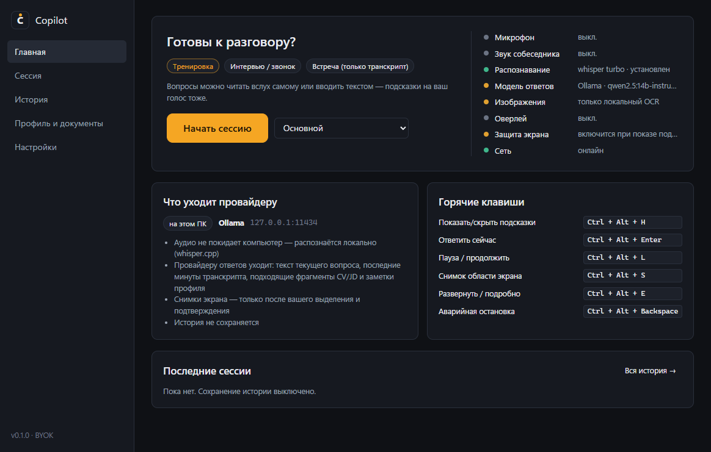
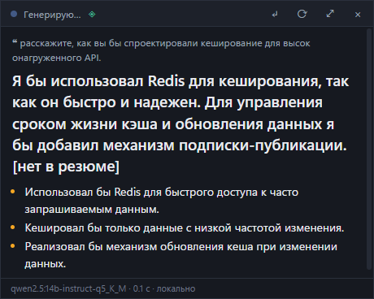
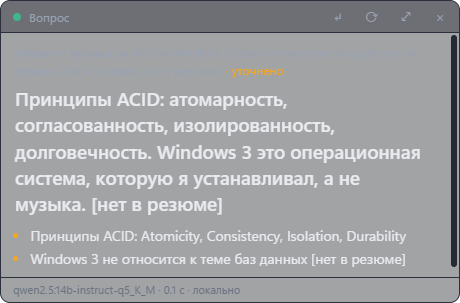
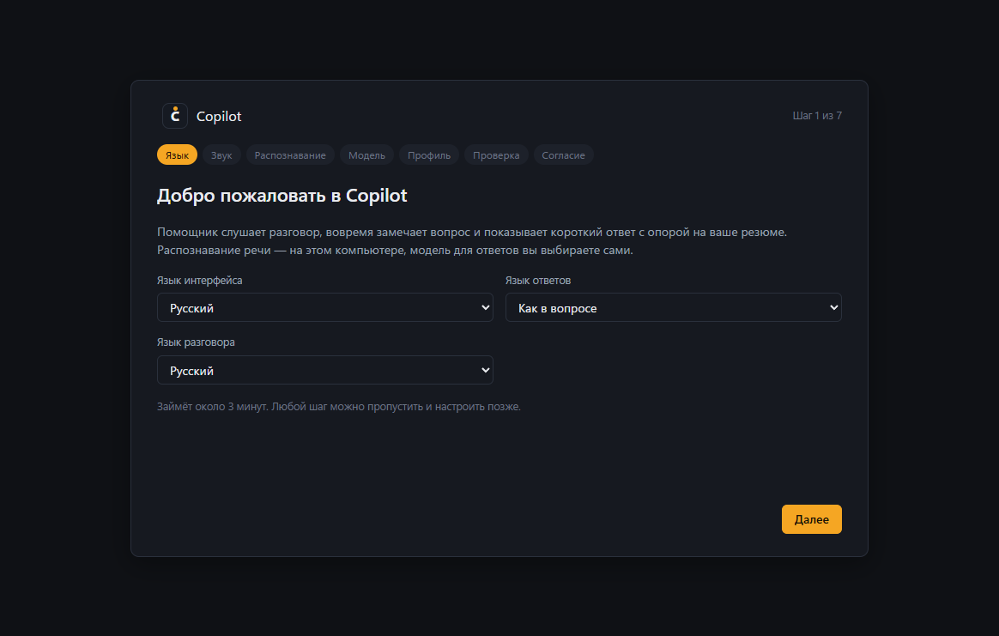
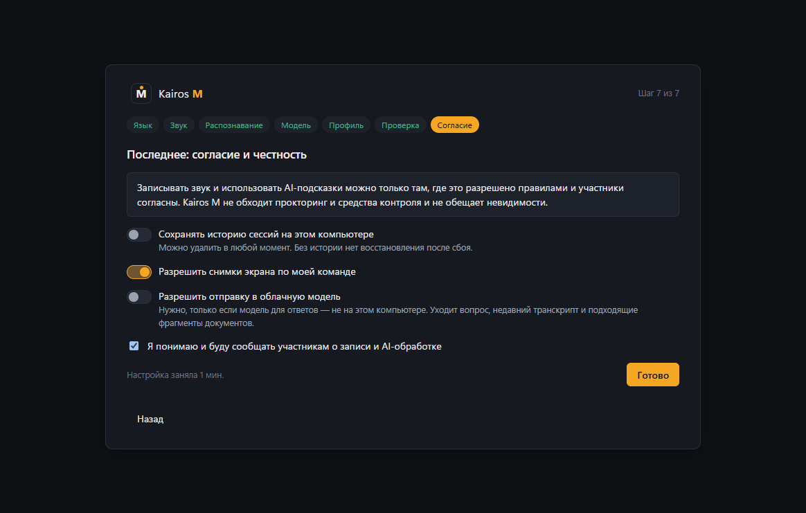
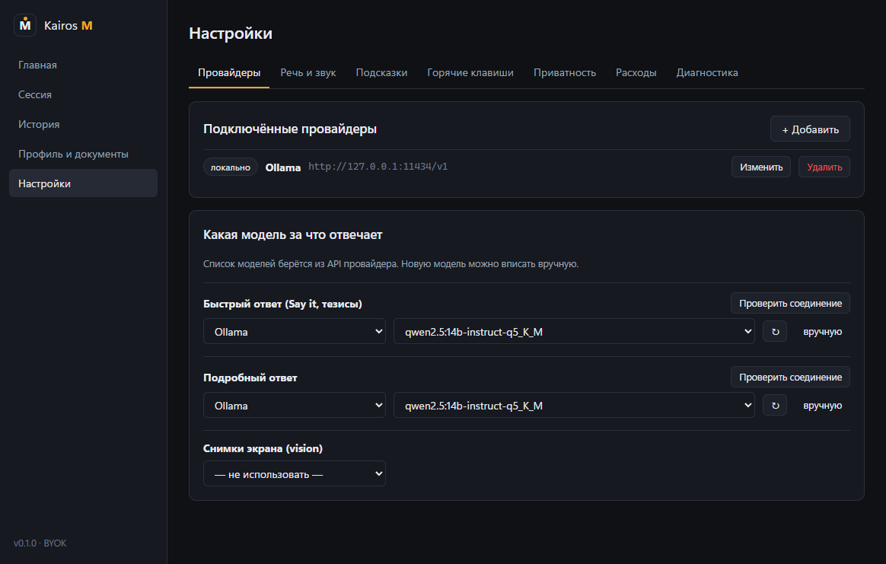
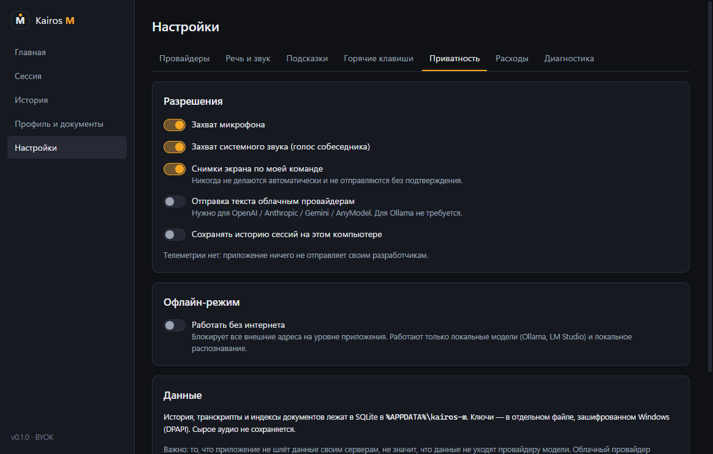

# Copilot

[](https://github.com/Magerko/copilot/actions/workflows/ci.yml)

Слушает разговор, распознаёт речь локально, замечает вопросы и показывает короткий
ответ в небольшом оверлее — с опорой на загруженные документы. Windows.

## Возможности
- Локальное распознавание речи (whisper.cpp): аудио не уходит в сеть и не пишется на диск.
- Модель ответов на выбор: локальная (Ollama, LM Studio) или облачная по ключу
  (OpenAI, Anthropic, Gemini, AnyModel, любой OpenAI-совместимый). Ключи — в DPAPI.
- Ответы опираются только на загруженные документы; не найденное помечается `[нет в резюме]`.
- Снимок выделенной области экрана → vision-модель или локальный OCR.
- Оверлей не забирает фокус, автоподстройка высоты, регулируемая прозрачность.
- Окна можно исключить из захвата экрана (флаг Windows SetWindowDisplayAffinity;
  поддерживается не всеми программами захвата).
- Сворачивание в трей, аварийная остановка, продолжение прошлой сессии.
- Учёт расхода по платным моделям и лимиты в настройках. Офлайн-режим блокирует внешние вызовы.
- Без аккаунта и своего сервера.

## Скриншоты


| Оверлей | Прозрачный фон |
|---|---|
|  |  |

| Онбординг | Согласия |
|---|---|
|  |  |

| Провайдеры | Приватность |
|---|---|
|  |  |

## Первый запуск
1. Язык → звук (микрофон и системный звук) → распознавание (загрузка ≈ 160 МБ).
2. Модель: [Ollama](https://ollama.com) подхватывается сама, иначе — провайдер и ключ.
3. Профиль и документы (PDF/DOCX/TXT).

## Горячие клавиши
| | Windows | macOS |
|---|---|---|
| Показать / скрыть подсказки | `Ctrl+Alt+H` | `⌃⌥H` |
| Ответить сейчас | `Ctrl+Alt+Enter` | `⌃⌥↩` |
| Пауза / продолжить | `Ctrl+Alt+L` | `⌃⌥L` |
| Снимок области экрана | `Ctrl+Alt+S` | `⌃⌥S` |
| Подробнее | `Ctrl+Alt+E` | `⌃⌥E` |
| Аварийная остановка | `Ctrl+Alt+Backspace` | `⌃⌥⌫` |

Все сочетания меняются в «Настройки → Горячие клавиши».

## Для разработчиков
```powershell
npm install
npm test
npm run dev       # разработка
npm run dist      # установщик в release/
```
Архитектура и решения — в `docs/pipeline/`.

## Контакты
- Telegram: [@magerdev1](https://t.me/magerdev1)
- GitHub: <https://github.com/Magerko/copilot>
